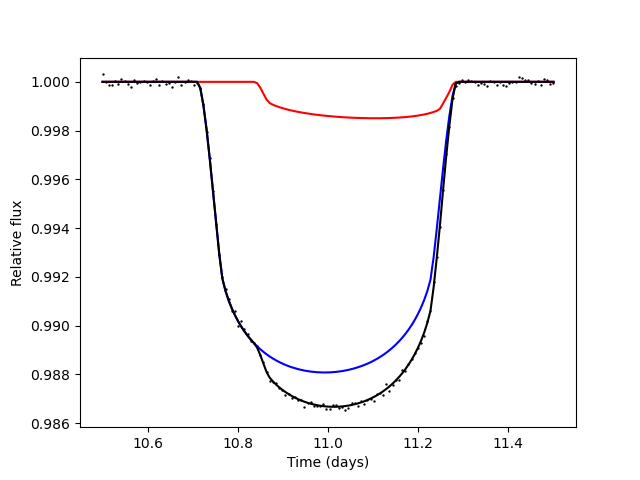
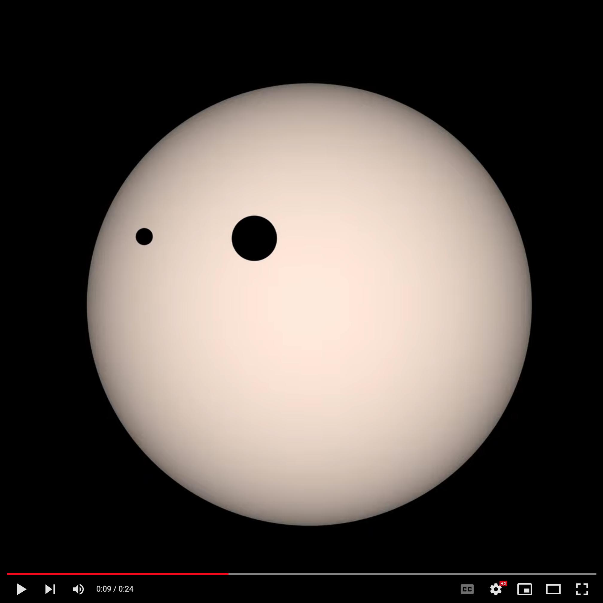

## Fast open-source exomoon transit detection algorithm

[](https://pypi.org/project/pandoramoon/)
[](https://pandora-moon.readthedocs.io/en/latest/index.html)
[](https://github.com/hippke/Pandora/tree/main/examples)
[](https://arxiv.org/abs/2205.09410)

> Named after the imaginary 5th moon of the gas giant Polyphemus, orbiting Alpha Centauri A, in the film [Avatar](https://james-camerons-avatar.fandom.com/wiki/Pandora). 

Pandora employs an analytical photodynamical model, including:
- Stellar limb darkening
- Full and partial planet-moon eclipses (exact analytic three-circle overlap, also on the stellar limb)
- Barycentric motion of planet and moon

To search for moons, Pandora includes a nested sampler (`NestedSampler`, see "Fitting" below) that fits planet+moon and planet-only models and returns their Bayesian evidences. Two tutorials show the workflow: [detection](https://github.com/hippke/Pandora/blob/main/examples/tutorial_detection.ipynb) and [characterisation](https://github.com/hippke/Pandora/blob/main/examples/tutorial_characterisation.ipynb) (a planet+moon injection into a light curve with stellar variability and red noise, detrending, the fast detection test, the full fit, corner plots and the Bayes factor). Pandora is fast: on the example data (3 transits at 30-min cadence) one likelihood evaluation takes about 3-4 microseconds on one core, and the complete planet+moon retrieval takes a few minutes on a 16-core machine. Through the `Likelihood` object, Pandora can also be used with other samplers, e.g. [UltraNest](https://github.com/JohannesBuchner/UltraNest) or [dynesty](https://github.com/joshspeagle/dynesty).


### Create transit light curve

The following Python code snippet illustrates how to work with Pandora. To keep it short, it omits the long list of required parameters. A complete and working example can be found [to create a Figure](https://github.com/hippke/Pandora/blob/main/examples/example_figure.py) and a [video](https://github.com/hippke/Pandora/blob/main/examples/example_video.py).
```
import pandoramoon as pandora
params = pandora.model_params()
params.per_bary = 365.25  # [days]
# (...) See tutorials for list of parameters
time = pandora.time(params).grid()
model = pandora.moon_model(params)
flux_total, flux_planet, flux_moon = model.light_curve(time)

plt.plot(time, flux_planet, color="blue")
plt.plot(time, flux_moon, color="red")
plt.plot(time, flux_total, color="black")
plt.show()
```


### Create video
With Pandora, you can create transit videos to understand, teach, and explore exomoon transits. Try it out:

```
video = model.video(
    time=time,
    limb_darkening=True, 
    teff=3200,
    planet_color="black",
    moon_color="black",
    ld_circles=100
)
video.save(filename="video.mp4", fps=25, dpi=200)
```
Videos approximate the true light curve as calculated by Pandora very well. They are, however, not pixel-perfect due to the underlying Matplotlib render engine. Klick the image to view the video:

[](https://youtu.be/89lEuPgrl8s)

### Log-likelihood for samplers
For fits (e.g. with UltraNest), use the `Likelihood` object. It precomputes the data terms once, evaluates the model only for samples near transit, and allocates no full-length arrays per call (one call on a 3-year, 1-minute-cadence light curve takes ~0.25 ms on one laptop core). It returns `-0.5 * nansum(((flux_total - data) / yerr)**2)`; NaN data get weight 0:

```
like = pandora.Likelihood(time, data, yerr, epoch_distance=params.epoch_distance,
                          supersampling_factor=1, occult_small_threshold=0,
                          hill_sphere_threshold=1.0)
logL = like(u1, u2, R_star, per_bary, a_bary, r_planet, b_bary, w_bary, ecc_bary,
            t0_bary, t0_bary_offset, M_planet, r_moon, per_moon, tau_moon,
            Omega_moon, i_moon, ecc_moon, w_moon, M_moon)
```
See the [characterisation tutorial](https://github.com/hippke/Pandora/blob/main/examples/tutorial_characterisation.ipynb). The model functions take the same arguments as `pandora()`:

| Function | Returns | Use |
|---|---|---|
| `pandora()` | fluxes (planet, moon, total) and planet/moon coordinates, float64 | `video()`, `coordinates()`, everything |
| `pandora_flux()` | the three fluxes, float64 | plots, `light_curve()`-like use |
| `pandora_deficit()` | `1 - flux` for the three components, float32 (half the memory; 2^-24 relative precision of the deficit) | own likelihoods on dense arrays |
| `pandora_window()` | `(idx, flux_planet, flux_moon, flux_total)` at the output cadences near transit only (flux is 1 elsewhere); `time_sorted=True` for ascending time | own likelihoods, sparse |

### Searching for moons: detection and characterisation
Two tutorials (synthetic data with stellar variability and red noise, detrending with wotan, injection and retrieval) show the whole workflow for first-time users: [detection](https://github.com/hippke/Pandora/blob/main/examples/tutorial_detection.ipynb) (a fast test, seconds per light curve) and [characterisation](https://github.com/hippke/Pandora/blob/main/examples/tutorial_characterisation.ipynb) (the full fit).

```
lc = pandora.prepare_lightcurve(time, flux, t0=t0, period=P, duration=T14)   # wotan biweight, mask 1.0 / window 4.0 T14; errors with the red-noise factor
like = pandora.Likelihood(lc["time"], lc["flux"], lc["flux_err"], epoch_distance=P)
priors = pandora.default_priors(t0_bary=t0, per_bary=P, r_planet=0.1)        # calibrated moon priors
det = pandora.detect(like, priors)              # dlnz, candidate (dlnz > 3 and the moon seen in >= 2 transits)
results = pandora.NestedSampler(like, priors).run()    # full fit; 30-min data are supersampled automatically
```

### Fitting: evidence and posterior with the built-in nested sampler
`NestedSampler` fits a `Likelihood` with priors, compares planet+moon with planet-only (Bayes factor) and checks its own convergence. Parameters are Pandora's (same names and units); give a prior or a fixed number for each. The limb darkening is set as `q1, q2` (Kipping) or `u1, u2` (e.g. `Normal` priors from stellar models, with `ld_correlation`). `w_bary`, `ecc_bary`, `ecc_moon` and `w_moon` default to 0.

```
from pandoramoon import NestedSampler, Uniform, LogUniform, Normal
R_sun = 696_342_000
priors = dict(q1=Uniform(0, 1), q2=Uniform(0, 1), R_star=Uniform(0.4 * R_sun, 1.2 * R_sun),
              per_bary=Uniform(360.25, 370.25), a_bary=Uniform(210, 220), r_planet=Uniform(0.07, 0.11),
              b_bary=Uniform(0, 1), t0_bary=11.0, t0_bary_offset=Uniform(-0.05, 0.05),
              M_planet=Uniform(1.5e27, 2.5e27), r_moon=Uniform(0.01, 0.07), per_moon=Uniform(0, 50),
              tau_moon=Uniform(0, 1), Omega_moon=Uniform(0, 180), i_moon=Uniform(0, 180), M_moon=Uniform(1, 1e27))
sampler = NestedSampler(like, priors, log_dir="fit_out")    # model="moon" (default) or "planet"
results = sampler.run()                                     # accuracy="medium" (logZ +-0.2, default) or "high"
sampler.print_results()
results["logz"], results["logzerr"], results["dlogz"]      # dlogz = logZ(moon) - logZ(planet only)
results["samples"], results["paramnames"]                  # equal-weight posterior samples
results["planet"]                                           # the planet-only fit, same structure
```
- **Results** follow UltraNest's result dictionary: `logz`, `logzerr`, `samples`, `weighted_samples`, `posterior` (mean, stdev, median, errlo, errup), `maxlikelihood`, `ncall`, `ess`, `H`, `paramnames`. In addition: `passed` (the self-checks), `history`, `nsteps`, `runs`, `multimodal`, `warnings`, and for moon fits `planet`, `dlogz`, `dlogzerr`, `jackknife` (the moon's fit improvement per transit).
- **Files** (`log_dir`) are laid out as in UltraNest: `info/results.json`, `info/post_summary.csv`, `chains/equal_weighted_post.txt`, `chains/weighted_post.npz`, `plots/corner.pdf` (`sampler.plot_corner()`, needs `corner`). The planet-only fit goes to `log_dir/planet/`. Every finished run is stored, so `resume="resume"` continues an interrupted fit; `"subfolder"` (default) or `"overwrite"` start a new one.
- **Sampler:** `pandoramoon.nss` is a compiled nested slice sampler. It runs independent runs on all cores (`threads=`), merges them and adds runs and longer chains until its error and reproducibility checks pass. The likelihood is compiled once per process (~15 s) and reused for every fit.
- **Moon orbit:** by default the moon's period and phase are sampled as phases at transit, which removes the comb of period aliases. An exact weight keeps your prior, evidence and posterior unchanged. This needs a `per_moon` prior with an upper bound ≤ the planet period and `tau_moon=Uniform(0, 1)`; otherwise the native parameters are sampled (`moon_phase=False` forces this).

### Installation
Install with `pip install pandoramoon` (videos and plots: `pip install pandoramoon[plots]`; light-curve preparation with wotan: `pip install pandoramoon[search]`). Compatibility has been tested for the latest Python 3.14 (January 2026):

```
conda create -n pandora_env python=3.14
conda activate pandora_env
pip install pandoramoon
```

To test, run:
```
git clone https://github.com/hippke/Pandora/
cd Pandora/examples
python example.py
```
This should show a Matplotlib figure and produce a video within a minute.

The first use after installation or an update compiles Pandora's numerical code (up to a few minutes, with a one-line notice on stderr; `PANDORA_QUIET=1` silences it); later runs load the cached result. Default settings and tuning values (model thresholds, sampler accuracy presets and fit rules, detection presets, light-curve preparation, default priors) are in `pandoramoon/settings.cfg`, physical constants in `pandoramoon/physics.cfg`; see [Configuration](docs/Interface.rst#configuration).

For sampling, the following packages will be useful:
```
pip install scipy cython
pip install ultranest dynesty h5py
```


Contributing
----------------
All my repositories embrace collaboration between humans and AI. Contributions are welcome, whether they are written by you, by an AI assistant, or by both together, and they will be handled promptly. Please open an [issue](https://github.com/hippke/pandora/issues) or a pull request.

Attribution
----------------
Please cite [Hippke & Heller (2022, A&A)](https://ui.adsabs.harvard.edu/abs/2022A%26A...662A..37H/abstract) if you find this code useful in your research. The BibTeX entry for the paper is:

```
@ARTICLE{2022A&A...662A..37H,
       author = {{Hippke}, Michael and {Heller}, Ren{\'e}},
        title = "{Pandora: A fast open-source exomoon transit detection algorithm}",
      journal = {\aap},
     keywords = {methods: data analysis, planets and satellites: detection, techniques: photometric},
         year = 2022,
        month = jun,
       volume = {662},
          eid = {A37},
        pages = {A37},
          doi = {10.1051/0004-6361/202243129},
       adsurl = {https://ui.adsabs.harvard.edu/abs/2022A&A...662A..37H},
      adsnote = {Provided by the SAO/NASA Astrophysics Data System}
}
```
